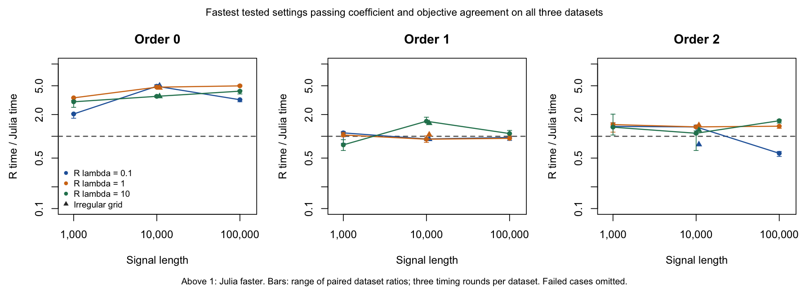
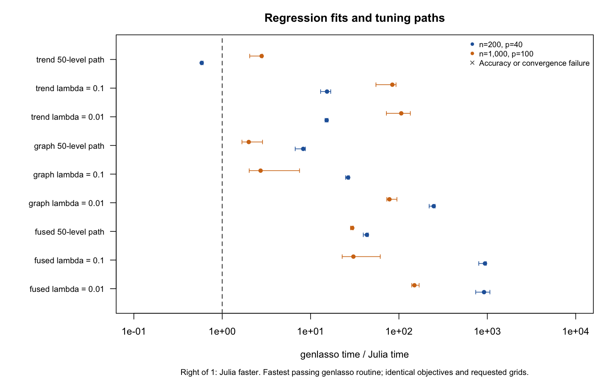

# Competitiveness of PR #83

The newer [default-accuracy report](../accuracy/RESULTS.md) calibrates Float64
residual defaults beyond linear signals and validates 15 targeted workloads on
fresh data. The tables below retain their original source and selected controls;
they are not measurements of every estimator at the latest public defaults.

The later [linear-stopping calibration](../stopping/RESULTS.md) changes the
default stopping rule for double-precision linear signal fits and validates it
on new datasets. The measurements below retain their original source and
controls; the newer report gives the updated linear-fit evidence.

Discovery campaign `20261025-cd80-competitive`, 2026-10-25. Final solver source:
`646a82c3c7e9348a1de5dc0257daeacbd7d3904b`. The PR remains draft for review of
these results and the implementation.

The implementation is competitive for the tested squared-loss problems. TV
denoising is generally faster than glmgen, while linear and quadratic trend
filtering have mixed results. Moderate design-based fused and graph regression
are strong cases. This evidence does not establish universal superiority, new
statistical accuracy, or a replacement for every feature of the R packages.

## Signal fits versus glmgen

These are end-to-end fit times in seconds, including model construction and
degrees of freedom. Each time is the median of nine measurements: three
independent datasets, each timed three times after warmup. The penalty is R λ=1
(`lambda_Julia=1/n`), with the fastest tested settings that pass the common
accuracy checks on all three datasets.

| Signal length | Order | Julia | glmgen | Paired R / Julia ratio |
|---:|---:|---:|---:|---:|
| 100,000 | 0, piecewise constant | 0.00876 | 0.0440 | 4.98 |
| 100,000 | 1, piecewise linear | 2.38 | 2.23 | 0.94 |
| 100,000 | 2, piecewise quadratic | 12.18 | 16.47 | 1.38 |
| 1,000,000 | 0, piecewise constant | 0.202 | 0.650 | 3.36 |
| 1,000,000 | 1, piecewise linear | 30.10 | 24.18 | 0.80 |
| 1,000,000 | 2, piecewise quadratic | 167.14 | 185.89 | 1.15 |

Ratios exceed one when Julia is faster. Ratios are medians of the three
within-dataset ratios, so they need not equal the ratio of the two pooled
medians. At one million observations, Julia's linear fit is about 24% slower;
quadratic filtering has a modest lead in this campaign. Its paired ratio range
is 1.11–1.18, which is descriptive variation across three datasets, not a
confidence interval.

Across all tested signal sizes, penalties, irregular grids and paths, the
paired ratio ranges are 0.93–5.01 for order zero, 0.76–2.04 for order one, and
0.58–1.64 for order two. In particular, the 10,000-point, 50-level TV path is
approximately tied (0.0220 s Julia versus 0.0210 s glmgen), and some weakly
penalized quadratic cases favor glmgen. The full case table is retained in
[optimized-selected-ratios.tsv](recorded/optimized-selected-ratios.tsv).

The million-point extension uses three new datasets, seeds 18201–18203. It
confirms the settings selected at 100,000 observations, rather than searching
the tolerance grid again. All three workloads pass accuracy, coverage and
convergence checks. It contains 54 selected fit timings and nine additional,
untimed tighter R references. See [million-point results](recorded/million/summary.json).

## Regression and paths versus genlasso

The reference is the fastest passing choice among generic genlasso with its
default QR backend, generic genlasso with `svd=TRUE`, and the specialized
`fusedlasso` or `trendfilter` routine. The latter is important for numerical
stability as well as speed. No deliberately slower generic backend determines
the headline comparison when a faster backend passes.

| 50-level path | Design | Julia seconds | genlasso seconds | Paired R / Julia ratio | Selected R routine |
|---|---:|---:|---:|---:|---|
| Sparse fused | 200 × 40 | 0.0129 | 0.540 | 43.36 | specialized |
| Sparse fused | 1,000 × 100, correlation 0.95 | 0.152 | 4.617 | 29.62 | specialized |
| Cyclic graph | 1,000 × 100 | 0.723 | 1.454 | 2.00 | specialized |
| Linear trend penalty | 200 × 40 | 0.0216 | 0.0126 | 0.59 | generic QR |
| Linear trend penalty | 1,000 × 100 | 0.197 | 0.537 | 2.79 | generic QR |

The small trend path favors R by about 1.7×. Single-fit Julia timings are often
much shorter, but the very large ratios in those cases require care: genlasso
traverses solution-path knots from infinity down to the requested penalty even
for a single requested fit. Julia solves that fit directly. For paths, all
methods return the same 50 requested levels, while genlasso also computes the
intermediate knots. These are comparisons of the public APIs for the requested
outputs, not of identical numerical work or isolated kernels. The results
support an advantage for supplied-grid workloads; they do not show that Julia
can replace an exact homotopy-path implementation.

Faster settings that fail accuracy remain in the raw results and candidate
lists. For example, generic QR misses the final correlated sparse-fusion path
point on all three datasets. An independent bounded dual QP supplies a feasible
lower bound: Julia and specialized genlasso have relative gaps below 5e-12,
while QR's gaps are 0.36–0.40%. The generic SVD result misses by 6.75% and 7.99%
on two datasets and succeeds on the third. This diagnosis applies to these
inputs and settings, not every use of either library. See the
[independent dual results](recorded/diagnostics/dual-check.tsv) and
[recreation code](dual-check.R). A separate cyclic-graph discrepancy and its
dual-QP check are also [retained](recorded/diagnostics/graph/).

## Profiling and optimization

CPU and sampled allocation profiles were collected separately from timings on
each of three datasets. The changes follow the observed bottlenecks:

- Correlated fused paths spent about 93% of baseline samples in BLAS
  matrix-vector products. Restarted accelerated proximal gradient with
  backtracking reduces iterations. Paths reuse centered data; moderate tall,
  dense Float64 designs also cache normal equations. Convergence is checked
  against the original design, with a direct-product fallback. In the final
  profiles, degrees-of-freedom SVD calculations become a substantial remaining
  cost.
- Trend signal profiles exposed repeated sparse triangular-solve allocations.
  Orders 1–3 now use compact banded Cholesky factors and allocation-free
  substitutions. A first compact implementation made dynamic substitution a
  new bottleneck; profiles over all three datasets led to band-width
  specialization and unrolled substitutions. Sparse generic-design solves
  retain a compatible allocating fallback on Julia 1.10.
- ADMM paths reuse factorizations whenever the chosen `rho` is unchanged,
  including the automatically selected value.

The following comparisons hold the Julia tolerances fixed and use the same
datasets, rather than attributing relaxed accuracy to optimization:

| Workload | Before seconds | After seconds | Paired speedup | Before → after cumulative allocation |
|---|---:|---:|---:|---:|
| Correlated fused 50-level path, p=100 | 4.732 | 0.152 | 31.15× | 335 MB → 64.9 MB |
| Fused 50-level path, p=40 | 0.0248 | 0.0129 | 1.87× | 15.5 MB → 10.8 MB |
| Quadratic signal, n=100,000, R λ=1 | 27.03 | 19.81 | 1.40× | 18.9 GB → 216 MB |
| Quadratic 50-level signal path, n=10,000 | 83.96 | 72.98 | 1.15× | 82.3 GB → 370 MB |

The quadratic single-fit optimized time here uses the fixed stricter controls;
the earlier comparison table selects a faster passing public-default setting.
MB and GB above are decimal **cumulative allocated bytes**, not peak memory.
The million-point workers reached cumulative process high-water RSS of about
1.64 GB for Julia and 1.56 GB for R. Those values include the runtime, inputs and
earlier fits and do not establish isolated per-fit memory superiority. Full
[optimization ratios](recorded/optimization-ratios.tsv) and
[replicated profiles](recorded/profiles/) are retained.

## Accuracy, controls and validation

There are 60 main workloads (42 signal, 18 regression) plus three million-point
workloads. Each selected solver/setting has three timing rounds on each of
three independent datasets. All 63 selected workloads pass coverage,
convergence and agreement checks. The public Julia defaults alone pass 48/60
main workloads; the stricter setting passes 60/60. Both settings and every
rejected reference candidate remain visible. Calibration cost is excluded, and
main-case setting selection uses the measured datasets; only the million-point
extension transports those choices to new datasets.

Every grid column must have relative coefficient error at most 1e-4 and
relative objective difference at most 1e-6. Coefficients from the first timing
round for each dataset/setting are saved and checked outside timing; all nine
rounds retain convergence and iteration records. Apart from the specific dual
diagnostics above, these are cross-solver agreement checks, not certified
optimality gaps. Large signals also use a separate glmgen `obj_tol=1e-12`
reference. All retained tighter references report success.

Both languages solve `RSS/(2n) + lambda_Julia * ||D beta||_1`, with
`lambda_R=n*lambda_Julia`, identical input files, no standardization and no
added ridge. Sparse fusion uses 0.25 times the l1 penalty plus 0.75 times TV.
The main paired Julia controls are `abstol=1e-8, reltol=1e-7`; cyclic graph
regression uses `1e-9, 1e-8`. Public defaults are `1e-7, 1e-6`. The iteration
cap is 20,000. glmgen is tested at objective stopping thresholds 1e-5, 1e-8 and
1e-10 with the same cap and thinning disabled. Its stopping rule differs from
Julia's, so equal numeric tolerances would not give equal accuracy. The report
chooses the faster passing Julia setting and fastest passing R setting per
workload, requiring success across all three datasets.

Timings use Julia 1.13.2 and R 4.5.3, genlasso 1.6.1 and glmgen 0.0.3, on
Discovery EPYC 7513 nodes. Each worker has one CPU and one BLAS/OpenMP thread.
Actual input types are warmed up on unrelated small problems; input I/O,
compilation and accuracy checks are excluded. R batches sub-20-ms fits to
reduce clock quantization. Allocations are nonexclusive and stages run in a
fixed order, sometimes concurrently within the task budget. Small timing
differences should be treated cautiously. Baseline and optimized v3 are timed
in one allocation; the four paths changed by the final normal-equation cache
are repeated in a later allocation. Unchanged v3 computations are reused.

The final source passes **344 checks on each of Julia 1.13.2 and 1.10.12** on
Discovery: 219 structured tests, 114 independent R golden checks and 11 Aqua
checks. These include direct banded-solve residual comparisons, correlated
designs, cached/uncached paths, intercepts and rank-deficient fallback cases.
GitHub CI and documentation workflows both pass for solver commit `646a82c`.
No Julia benchmark, profile or test process in this campaign ran on the laptop.

## Supported scope and remaining limits

The implementation provides Gaussian squared-loss fits, explicit decreasing
lambda grids with warm starts, CV, AIC and BIC. Generic design-based degrees of
freedom use dense null-space/rank calculations and can dominate a now-faster
solve. The normal-equation cache is limited to tall Float64 designs with
`n >= 4p` and `p <= 2048`; its cached matrix uses at most 32 MiB. Generic dense
design/DF calculations remain intended for moderate p. Million-point direct
signal fits do not establish million-point CV scalability, since signal CV
currently uses the generic design route.

The R alternatives retain capabilities outside this implementation's scope:
[genlasso computes solution-path knots](https://github.com/ryantibs/genlasso),
and [glmgen supports observation weights, non-Gaussian families and prediction
at new locations](https://github.com/glmgen/glmgen/blob/9e6061503d6dd103712a0c07f6be7293c1c58aaf/R_pkg/glmgen/R/trendfilter.R).
This PR does not implement those capabilities. The KernelSmoothing example is
illustrative and is not a tuned predictive comparison. Agreement with the
same optimization objective does not imply a statistical prediction advantage.

The comparisons and targeted optimizations are complete. The next PR step is
review of the solver changes, numerical fallback behavior and documented
scope. Remaining performance opportunities include linear trend filtering at
large n and dense degrees-of-freedom calculations; the present evidence does
not require claiming those are solved before reviewing this implementation.

## Reproduction and retained evidence

[README.md](README.md) describes the harness, controls and rerun stages.
[provenance.json](recorded/provenance.json) records source hashes and dependency
commits. `recorded/main/` contains raw per-replication timings and overrides;
`recorded/accuracy/` contains all common checks, including failures;
`recorded/summary.json` contains compact stage summaries and candidate selection.
The million-point extension is separate. Synthetic inputs and coefficient
binaries remain in the remote run directory; `generate.R` and `million.R`
recreate inputs from the recorded seeds.

The run record preserves failed wrappers and repairs, including the Julia 1.10
sparse `ldiv!` incompatibility and a scientific-notation summary parser failure.
These were corrected before final validation. Slurm job IDs, exact intervals
and requested resources are in [accounting.tsv](recorded/accounting.tsv). The
campaign stayed within 6 concurrent CPUs and 16 GB; allocation union time,
including the earlier issue-80 implementation work, was approximately 113
minutes within the task's 120-minute allowance. Queue wait is excluded.
